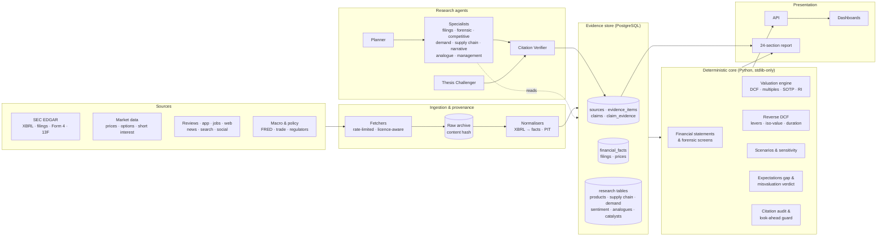

# Architecture (revised)

## Principles

1. **Deterministic core, AI periphery.** Every number is produced by a pure, tested Python
   function. Language models plan research, read documents and draft text. They feed *evidence*
   into the core and never *numbers they made up*.
2. **Evidence-first.** Data enters the system as an `EvidenceItem` with a source, epistemic
   status and publication time. Analyses reference evidence IDs, not free text.
3. **Point-in-time by construction.** Every query is parameterised by a decision date. Anything
   published later is invisible.
4. **Separate conclusions.** Business quality, intrinsic value and market expectations are three
   pipelines that meet only in the report.
5. **Honest gaps.** Unimplemented or unevidenced analysis renders as *Not assessed*, never as
   filler.

## System diagram

## Layers

| Layer | Responsibility | Current implementation |
|---|---|---|
| **Ingestion** | Fetch, archive (hash), normalise, timestamp | `data/http.py` (retrying, throttled, SHA-256-verified cache; typed errors), `data/sec_edgar.py` (lookup, submissions, companyfacts; annual, quarterly and TTM; revisions; per-figure provenance), `data/sec_case.py` (SEC → Case), `data/case_file.py` |
| **Data validation** | Accounting identities, independent tie-outs, freshness, restatements | `validation.py` |
| **Evidence model** | Provenance, epistemic status, look-ahead guard, staleness, citation audit | `evidence.py` |
| **Persistence** | Relational store with evidence links and audit log | `schema/deepterminal.sql` (tested in SQLite; Postgres target) |
| **Finance primitives** | Time value, root finding with multi-root scan, WACC/CAPM, beta | `finance/` |
| **Statements** | Ratios, FCF after SBC, forensic flags | `financials/statements.py` |
| **Valuation** | DCF, bridge, multiples, comparables, historical multiples, RI/DDM, SOTP, NAV, normalisation, method selection | `valuation/` |
| **Expectations** | Reverse DCF levers, iso-value surface, growth duration, expectations gap, 13-step verdict | `valuation/reverse_dcf.py`, `valuation/expectations.py` |
| **Orchestration** | Runs a case end to end with temporal and citation checks | `pipeline.py` |
| **Presentation** | Markdown report (24 sections), HTML Market Expectations dashboard, CLI, JSON | `reporting/`, `cli.py` |
| **Agents** | Research planning and evidence gathering | Design in [AGENTS.md](AGENTS.md); Intermediate milestone |

## Data flow for one analysis

1. **Case assembly.** Point-in-time financials (EDGAR, filtered by `filed ≤ analysis_date`), a
   timestamped price, capital-structure items, assumptions with rationales and sources, and peer
   data are gathered into a *case file* (JSON; DB-backed later). The case file is hashed so every
   run is reproducible.
2. **Guards.** `enforce_point_in_time` rejects late evidence. The bridge validates double counting.
3. **Valuation.** Method selection, then base DCF, scenarios, multiples and comparables.
4. **Expectations.** Market EV from the *same* capital structure, then one-lever reverse DCFs,
   the iso-value surface, growth duration and the gap versus history, peers and consensus.
5. **Verdict.** A qualified label from an explicit rule. Research steps are *not performed*
   unless evidence exists.
6. **Audit.** Citation audit, synthetic-data flags and stale-data flags.
7. **Render.** Report, dashboard and JSON. All numbers come from step 3–5 objects, so views
   cannot disagree.

## Deterministic / LLM boundary

| Model capabilities | Model restrictions |
|---|---|
| Plan research and choose tools | Produce any number that enters a calculation without a source |
| Extract values from documents **with locator + quote** (then verified mechanically) | Fill missing financial data |
| Classify evidence and propose epistemic status | Override the citation verifier |
| Generate hypotheses, counterarguments and scenario narratives | Assign scenario probabilities without calibration evidence |
| Draft report prose around computed outputs | Issue buy/sell recommendations |

## Security architecture
- **Untrusted content isolation.** Fetched documents are passed to agents as data, inside
  delimiters. Agents have no tool that executes fetched content, and their tools are allow-listed
  per role.
- **Secrets.** Environment or secret manager only (e.g. `DEEPTERMINAL_SEC_USER_AGENT`, API keys);
  `.gitignore` excludes caches and outputs.
- **Licensing enforcement.** Each source row carries `licence`, and exporters drop fields whose
  licence forbids redistribution.
- **Auditability.** Each agent run stores a prompt hash, its tools, and how many claims it
  produced and how many were rejected. `audit_log` is append-only.
- **Supply chain.** The core is stdlib-only, dev dependencies are pinned in CI, and there is no
  dynamic code loading.

## Target deployment (Intermediate+)
- PostgreSQL holds the evidence store; object storage holds the raw archive.
- FastAPI serves the core over HTTP. A React front-end hosts the Valuation Laboratory (live
  recompute through the API, so there is no client-side maths duplication).
- A worker queue runs ingestion and agent jobs, with scheduling for filings and price refresh.
- Research uses rule-based analysis or optional Ollama models by default. Hosted model providers
  require explicit opt-in.
